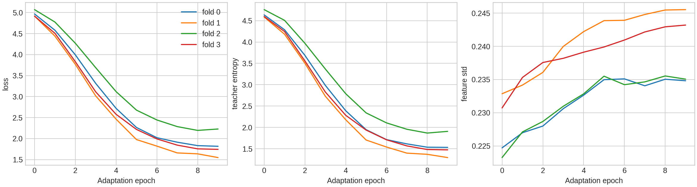
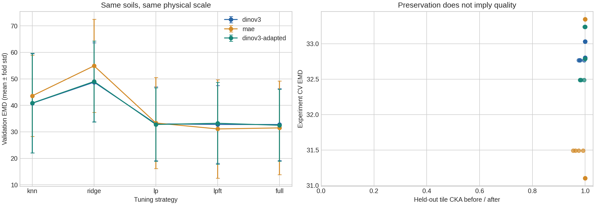

# Part 3: SSL results and requirement review

Reviewed on 2026-11-08. Completed training: Kaggle **version 8**, 18 recipes × four unchanged sample folds. No new training, inference or submissions were run for this report. Lower EMD is better. Machine-readable results, all 18 OOF/test prediction sets, receipts, histories and checkpoint references are in [part3_results.json](part3_results.json).

## Requirement coverage

| Part 3 requirement | Evidence / status |
|---|---|
| At least two SSL encoders | DINOv3 ViT-S/16 and MAE ViT-B/16 |
| Frozen features → LP → LP-FT → full FT or LoRA | k-NN, Ridge, LP, LP-FT and full FT for both encoders; LoRA is an alternative, not an additional requirement |
| DINO-style domain adaptation and repeat comparison | Four separate DINOv3 adaptations; all five strategies repeated on the same folds |
| Same-fold before/after matrix | All 15 main configurations and three ablations below; complete OOF records verified |
| Adaptation training curves and GPU cost | Ten epochs per fold; saved curves, entropy/feature diagnostics and compute records |
| Augmentation and feature-distortion answers | Discussion and held-out-tile CKA below |
| Ablation study | CLS-only pooling, uniform backbone LR, no color jitter |

**The Part 3 experimental requirements are covered.** Remaining submission/report gaps are listed at the end; further training is not required just to complete this section.

## Protocol

There are 24 labelled physical soils, four folds, six held-out soils per fold. Every strategy uses the same folds. Domain adaptation uses only the 18 training soils in its fold: no validation/test photos or labels. All 64 mm native crops are resized directly to 224 px; overlap-area weights pool tiles and photos have equal sample weight. Source PPM retains the assumption of full-image resizing without unknown cropping. Background remains unmasked.

Descriptors concatenate CLS and mean patch tokens, excluding DINOv3 registers. MAE uses mask_ratio=0 and deterministic patch order. Ridge standardization is train-only (alpha=100); cosine k-NN uses k=3 and temperature=.07. LP is a linear mass-bin head with EMD. LP-FT starts from the best LP head; full FT starts with a fresh head. A single best epoch is selected by held-out sample EMD; no camera gate or epoch ensemble.

Official weight revisions and all experiment settings are preserved in the JSON identity. DINOv3-S and MAE-B differ in capacity and pretraining data, so this is a released-encoder comparison, not an isolated test of the pretraining objective.

## Complete result matrix

CV is mean ± sample standard deviation of four fold EMD scores. Public LB comes from Kaggle receipts matched by exact CSV filename. “—” means not submitted. Private LB is unavailable for all rows.

| Recipe | CV EMD ± std | Public LB | Training GPU h | Shared feature GPU h | Peak GiB |
|---|---:|---:|---:|---:|---:|
| dinov3-knn | 40.801 ± 18.740 | — | 0.000 | 0.021 | 0.00 |
| dinov3-ridge | 48.752 ± 14.890 | — | 0.000 | 0.021 | 0.00 |
| dinov3-lp | 33.031 ± 13.945 | — | 0.002 | 0.021 | 0.14 |
| dinov3-lpft | 32.803 ± 14.689 | — | 0.247 | 0.021 | 1.86 |
| dinov3-full | 32.766 ± 13.552 | — | 0.319 | 0.021 | 1.87 |
| mae-knn | 43.599 ± 15.336 | — | 0.000 | 0.025 | 0.00 |
| mae-ridge | 54.913 ± 17.604 | — | 0.000 | 0.025 | 0.00 |
| mae-lp | 33.346 ± 17.224 | — | 0.003 | 0.025 | 0.38 |
| mae-lpft | 31.101 ± 18.615 | 67.45990 | 0.470 | 0.025 | 4.17 |
| mae-full | 31.493 ± 17.684 | 75.79965 | 0.559 | 0.025 | 4.17 |
| dinov3-adapted-knn | 40.868 ± 18.798 | — | 0.000 | 0.019 | 0.00 |
| dinov3-adapted-ridge | 49.008 ± 15.254 | — | 0.000 | 0.019 | 0.00 |
| dinov3-adapted-lp | 32.789 ± 13.843 | 66.35504 | 0.001 | 0.019 | 0.24 |
| dinov3-adapted-lpft | 33.239 ± 15.456 | — | 0.285 | 0.019 | 1.86 |
| dinov3-adapted-full | 32.488 ± 13.545 | 64.48640 | 0.343 | 0.019 | 1.86 |
| dinov3-ridge-cls | 45.383 ± 12.471 | — | 0.000 | 0.021 | 0.00 |
| dinov3-lpft-uniform-lr | 33.828 ± 15.633 | — | 0.248 | 0.021 | 1.87 |
| dinov3-lpft-no-color | 32.689 ± 14.822 | 61.47339 | 0.245 | 0.021 | 1.87 |

The full two-T4 session took **1.825 wall hours / 3.650 allocated GPU-hours**, including setup, caching, diagnostics and W&B upload (excluding VM boot). The per-recipe column measures its training/validation stage. Shared feature extraction is not charged repeatedly; LP-FT additionally requires its LP stage. Adaptation is a separate shared cost below. CPU fits use zero GPU-hours. Memory is peak allocated memory.

## Five public submissions

| Model / CSV | Submission ID | Public EMD |
|---|---:|---:|
| submission_mae-lpft.csv | 58106517 | 67.45990 |
| submission_mae-full.csv | 58106513 | 75.79965 |
| submission_dinov3-lpft-no-color.csv | 58106508 | 61.47339 |
| submission_dinov3-adapted-lp.csv | 58106501 | 66.35504 |
| submission_dinov3-adapted-full.csv | 58106487 | 64.48640 |

These submissions were recorded on **2026-11-08, 00:49–00:50 Kyiv time** (the JSON preserves the original UTC timestamps). The screenshot and API scores agree. The fifth slot was explicitly reserved for `dinov3-adapted-lp`; the other four were selected by CV including ablations. It replaced `dinov3-full` (CV 32.766 versus 32.789).

**Best CV: mae-lpft, 31.101 ± 18.615; Public LB 67.45990. Best public SSL result: dinov3-lpft-no-color, 61.47339.** This reverses the ranking of these candidates. The earlier Swin tiles frozen public result was 45.21894; none of the five submitted SSL candidates beats it. This does not establish why the gap exists. Camera/domain shift, scale/background sensitivity and selection on only 24 soils remain hypotheses, not measured explanations. Do not choose the final recipe from these five public scores.

The five CSV exports from the existing Kaggle inference notebook were also checked:
each has valid cumulative curves, identical test IDs and 10 test samples.
The largest pointwise difference from the original training-time four-fold
exports is **0.000000 percentage points**. Exact exported-file SHA256 hashes
and prediction rows are saved in the JSON. Receipt-to-model matching uses the
exact filename; the submissions API does not provide a hash of the uploaded file.

## Domain adaptation: did it help?

Four ten-epoch continuations cost **0.485 GPU-hours**. This is a small DINO-style continuation with centering, sharpening and an EMA teacher, not a reproduction of full DINOv3 pretraining.

| Strategy | Adapted − original CV EMD | Improved folds / 4 |
|---|---:|---:|
| knn | +0.066 | 1 |
| ridge | +0.255 | 1 |
| lp | -0.241 | 3 |
| lpft | +0.436 | 1 |
| full | -0.278 | 2 |

**Conclusion:** small gains for LP (−0.241, three folds) and full FT (−0.278, two folds), but worse k-NN, Ridge and LP-FT. There is no consistent overall improvement at this cost, and four folds do not establish statistical significance. There is no matched before/after Public LB pair, so adaptation’s effect on public performance is not measured.

Across the four folds, loss drops from 4.915–5.069 to 1.549–2.228, teacher entropy from 4.586–4.759 to 1.294–1.907, and final marginal entropy is 3.465–4.186. Feature standard deviation stays nonzero and increases slightly; held-out centered RankMe changes only slightly. These checks show no obvious constant-feature collapse, but falling loss and entropy alone do not prove useful adaptation or exclude partial prototype concentration. All recorded adaptation epochs have zero skipped AMP steps.

## Feature distortion and the frozen-versus-tuned question

| Source | LP CKA | LP-FT CKA | Full FT CKA |
|---|---:|---:|---:|
| dinov3 | 1.000000 | 0.999831 | 0.982837 |
| mae | 1.000000 | 0.999759 | 0.971291 |
| dinov3-adapted | 1.000000 | 0.999284 | 0.985412 |

CKA is centered linear CKA on the same deterministic held-out tiles before/after tuning, up to four tiles per photo and 256 total. The table averages four fold values. Tiles within a soil are correlated; they are not independent evidence. Adaptation itself has mean CKA 0.996593.

**Can tuning be worse than a frozen encoder? Yes in this study:** adapted LP-FT scores 33.239 versus 32.789 for adapted LP with a frozen encoder (+0.450 EMD), despite CKA 0.999284. Full FT still improves over that LP (32.488). Full FT beats frozen Ridge and k-NN for all three sources; those baselines do not show a degradation here.

LP-FT preserves representations more than full FT, but this does not guarantee better prediction: it beats full FT only for MAE, and has higher fold-score standard deviation for all three sources. With 18 training soils, overfitting or shifts in predictive directions are plausible explanations; CKA is not a causal test of either. High CKA can coexist with worse downstream EMD.

## Ablations and hypothesis review

| Hypothesis | Observed outcome |
|---|---|
| H-SSL-01: DINOv3 frozen Ridge beats MAE; MAE may benefit more from tuning | Supported: Ridge 48.752 vs 54.913, but full FT reverses the ranking, 32.766 vs 31.493. Architectures/data differ. |
| H-SSL-02: LP-FT is more stable and preserves features | CKA preservation supported; universal quality/stability advantage not supported. MAE LP-FT wins, DINOv3 LP-FT does not; all LP-FT fold std values exceed full FT. |
| H-SSL-03: adaptation may help transfer | Mixed: LP/full FT improve slightly, three other strategies worsen; +0.485 shared GPU h. |
| H-SSL-04: CLS + patch mean beats CLS alone | Not supported: CLS-only Ridge 45.383 beats concatenation 48.752 by 3.370 EMD. |
| H-SSL-05: layer decay .75 helps | Supported in this comparison: LP-FT 32.803 vs uniform LR 33.828, a 1.026 EMD advantage. |
| H-SSL-06: mild color jitter helps | Not supported: no-color LP-FT 32.689 vs jitter 32.803, a small 0.113 EMD gain without jitter. No matched public baseline. |

No additional seeds/splits were run to determine whether these small differences persist. The original pre-run predictions remain unchanged in [HYPOTHESES.md](HYPOTHESES.md).

## Which augmentations destroy useful target information?

Zoom or random resized crops without correcting physical scale change apparent grain size at the encoder’s input. Strong blur removes fine-grain evidence. MixUp/CutMix image-area proportions do not justify interpolating a whole-soil mass distribution. These were excluded. Quarter-turns/flips preserve scale; mild color jitter was tested with the no-color ablation. These are task-based arguments, not an additional quantitative augmentation-destruction experiment.

## Artifacts and reproducibility

- [Completed SSL training](https://www.kaggle.com/code/denysmykhailov/soil-ssl-part-3-dinov3-mae), version 8; study ID `43e79cea8f5be6e997fc98c1152549298c8a4cf37b7ac9e8b00c7f5339462697`.
- [Inference notebook](inference.ipynb) / [Kaggle inference](https://www.kaggle.com/code/denysmykhailov/soil-grain-size-inference): five separate CSVs; each averages four matching checkpoints.
- [Submission receipts](https://www.kaggle.com/competitions/soil-grain-size-from-photos/submissions): five complete public results; IDs and UTC timestamps stored in JSON.
- `part3_results.json` stores 18 × 24 OOF rows, test predictions, fold assignments, 18 fold-score sets, CKA, adaptation curves, compute and run links. The eight model artifact references are below; configs, weights, environment, lockfile and complete source remain in Kaggle Outputs.

| Encoder / fold | W&B model artifact |
|---|---|
| dinov3/fold_0 | `public-team/soil-grain-size/ssl-dinov3-fold-0:v0` |
| dinov3/fold_1 | `public-team/soil-grain-size/ssl-dinov3-fold-1:v0` |
| dinov3/fold_2 | `public-team/soil-grain-size/ssl-dinov3-fold-2:v0` |
| dinov3/fold_3 | `public-team/soil-grain-size/ssl-dinov3-fold-3:v0` |
| mae/fold_0 | `public-team/soil-grain-size/ssl-mae-fold-0:v1` |
| mae/fold_1 | `public-team/soil-grain-size/ssl-mae-fold-1:v0` |
| mae/fold_2 | `public-team/soil-grain-size/ssl-mae-fold-2:v0` |
| mae/fold_3 | `public-team/soil-grain-size/ssl-mae-fold-3:v0` |

## What remains for Part 3 / submission

1. **No mandatory additional Part 3 training remains.** Two encoders, all strategies, fold-local adaptation, curves, CKA and three ablations are complete and documented. LoRA is not required in addition to full FT.
2. **Public LB is missing for 13 of 18 recipes.** The overall assignment asks for LB for every reported experiment. If applying that requirement literally, submit their already saved four-fold CSVs; no retraining is needed. Otherwise keep these rows explicitly unsubmitted rather than assigning them a score.
3. **Private LB is not available in the receipts.** Add it when available; it cannot be inferred from public scores.
4. **Attach the AI-use transcript and prepare the defence.** Disclosure is present, but the report itself is not a transcript. Explain the failed hypotheses, camera/scale limitations and CV/LB disagreement.
5. **Pre-run git-history requirement:** hypotheses exist, but the owner requested no new commits. A pre-run commit cannot be created retrospectively. No commits were made for this review.

Parts 4–7 (interpretability/shortcut controls, broader optimisation conclusions, cross-family comparison and ensemble) are separate work, not missing experiments inside Part 3. Additional repeats and robustness tests would strengthen the conclusions but are not needed to fill the Part 3 matrix.
